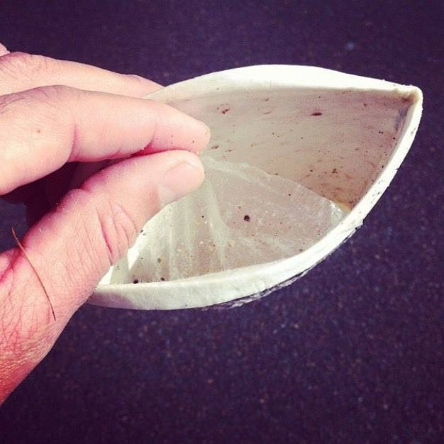

Kepada Ibu, Ayah, Pakcik, Makcik, Anak-anak dan Saudara-saudari yang dikasihi,

Assalamualaikum dan salam sejahtera.

Saya ingin berkongsi sesuatu yang semakin meresahkan saya: bahaya plastik terhadap kesihatan dan alam sekitar. Kita mungkin tidak sedar, tetapi zarah-zarah mikroplastik terdapat dalam makanan, air minuman dan udara yang kita hirup setiap hari.

Satu kajian yang dibiayai oleh National Institutes of Health (NIH) mendapati setiap satu liter air botol yang dibeli di kedai boleh mengandungi kira-kira 240,000 zarah plastik.

## Lapisan plastik dalam cawan kertas

Untuk pengetahuan umum, cawan kertas sebenarnya kalis air kerana wujudnya satu lapisan nipis jenis plastik. Apabila minuman panas dimasukkan, lapisan plastik tersebut boleh mula terurai tanpa disedari dalam masa beberapa minit sahaja.

Pada masa yang sama, bahan kimia seperti **Bisphenol A (BPA)** dan **Dibutyl Phthalate (DBP)** boleh terlepas daripada lapisan plastik yang terurai dan, apabila diminum, boleh meniru fungsi hormon estrogen serta memberi kesan kepada kesihatan jangka panjang. BPA ditambah sebagai bahan tambahan plastik (*plastic additive*), manakala DBP digunakan sebagai pelembut plastik (*plasticizer*).

Itulah sebabnya adanya bekas plastik jenis "BPA-free" yang dihasilkan tanpa menggunakan BPA.

Lebih membimbangkan, **Styrofoam** yang digunakan untuk makanan panas boleh melepaskan bahan kimia asasnya, iaitu styrene, yang diklasifikasikan sebagai bahan yang berkemungkinan menyebabkan kanser.

## Bekas yang boleh diguna semula

Ini antara sebabnya sejak dulu lagi, saya cuba tidak membeli minuman bungkus, air botol plastik mahupun membancuh minuman panas menggunakan cawan kertas. Saya lebih suka bekas minuman jenis logam yang dibawa ke klinik.

Setiap kali membeli makanan yang datang bersama sup, saya menggunakan termos logam bercorak bunga berwarna ungu, manakala satu lagi bekas berwarna jingga terang saya gunakan untuk minuman. Pelik atau tidak, kesihatan diri jauh lebih penting. Saya percaya perubahan sebegini bermula dengan keberanian.

## Sedihnya!

Satu lagi nasihat saya untuk kelestarian alam sekitar demi generasi masa depan. Mungkin anda pernah melihat gambar seekor penyu yang ditemui dengan straw plastik tersangkut di hidungnya. Inilah straw plastik yang kita guna dan buang. Tidakkah ini membuatkan kita termenung sambil bertanya, "Kenapakah hidupan laut yang tidak bersalah terpaksa menanggung akibat kelalaian kita?"

Yang selalu menyedihkan saya ialah longgokan plastik di tapak pelupusan berhampiran. Bau busuk dan pemandangan ini membuatkan saya terfikir: jika kita semua mengambil langkah kecil, kita boleh mengurangkan beban bumi ini.

## Saya menyeru kita bertekad hari ini juga

- Gunakan botol dan bekas yang boleh diguna semula.
- Tolak sudu, garfu dan straw plastik.
- Sokong restoran yang mesra alam.
- Galakkan pemilik perniagaan menerima bekas pelanggan.

Ya, tidak dapat dinafikan memang sukar untuk mengubah tabiat, tetapi kita boleh saling memotivasikan. Jadikan bekas makanan kita satu simbol perubahan: berwarna-warni, praktikal dan penuh harapan.

Dengan kasih dan harapan,

**Kartini Rahim** 
Naib Presiden, Pertubuhan Pelindung Khazanah Alam Malaysia (PEKA) 
Anak, ibu, saudara dan rakan perjuangan anda
